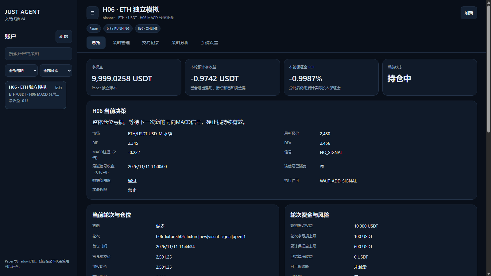
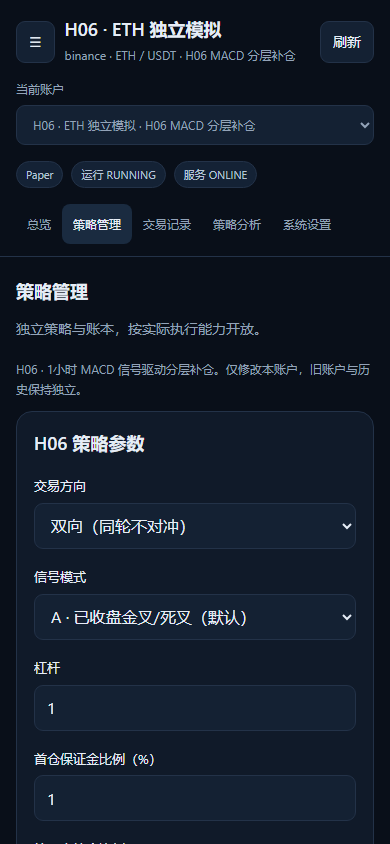

# H06 MACD 分层补仓 V1：交付与研究报告

> 本文是提交3654944的第一轮历史基线记录，测试数量、源码指纹和结果均按该提交解释。第二轮工程修复及独立研究见 [optimization/REPORT.md](optimization/REPORT.md)，不将旧收益改写为新实验。

## 结论

H06 已实现可执行的独立 Research / Shadow / Paper 引擎，而非仅展示指标。开仓、按新信号补仓、半仓止盈、反向退出、强制风险退出、订单恢复、费用核算及完整轮次结算均有回归覆盖。**尚不能证明盈利，禁止 Live；本轮未部署生产、未切换或启动旧账户。**

在冻结的2024—2025年样本外回放中，默认三次补仓提高胜率，但未改善ETH/BTC的净期望，且扩大了单笔尾部损失。不要据此增加杠杆、放宽风险边界，或自动把表现偶然较好的模式晋升为默认。

## 基线与范围

- GitHub main 基线：`0681f2b78cffd9fbaee316b5c10426c97df99fb1`。分支：`codex/h06-macd-scale-in-v1`。最终 commit 和 PR URL 见交付消息及 PR。
- 新策略：`macd_scale_in_v1`；修订：`H06_MACD_SCALE_IN_V1_20261111`。
- V3、Short-Term、4H 的核心策略代码与参数文件未修改；仅修改统一注册、路由、权限、组合风险适配和前端集成。
- 远端main仍为旧V4终端，和当前生产的经典界面有差异。本分支不宣称已经安全替换生产；部署前需要显式解决版本差异。

## 执行与风控验收

- LONG_ONLY / SHORT_ONLY / BOTH均实现。同账户单轮只允许一个方向，退出信号不能立即被重复用于反手。
- 四层保证金1%/1%/2%/2%，按轮初冻结已结算权益计算；最大3次补仓。仅亏损+新同向已收盘MACD信号可补仓。
- 亏损且仍有补仓层时，反向信号只记录；盈利反向或层级耗尽亏损反向才退出。硬止损不等待MACD。
- 本轮净保证金ROI达到100%，目标退出当前实际数量50%，同轮仅一次。部分成交与拒单后继续补足原目标数量，不能反复按余仓再算50%。
- 部分止盈启动后不再补仓，等待反向退出；硬风险和手动安全退出优先。
- 默认1x，研究硬上限5x；单轮最大净亏损预算不高于1%、日亏损不高于2%、总保证金预算不高于6%。不是无限马丁。
- 固定最大净亏损止损与可选ATR结构保护已实现。补仓不得放宽旧止损，实际数量受风险和合约步长限制。
- 风险预算不是成交保证；跳空、流动性不足、断网时可能超过预算，记录实际模拟损失。
- 暂停仅禁止开仓/补仓，保留风险退出、盈利保护和订单核验。未知订单不自动清除。
- 当前轮次锁定配置；参数保存只对下一轮生效，不自动启动或重置权益。

## 数据与数值验证

- 来源：Binance官方USD-M月度档案。2020-01至2025-12，ETHUSDT、BTCUSDT各52,608根1H K线，连续无缺口。
- 432个K线/资金费/标记价档案全部通过官方SHA-256校验，清单为 `data-manifest.json`。
- 各币种6,576个实际资金费率事件；部分时点缺少档案内对应标记价：ETH 6个、BTC 24个。未伪造。
- 历史资金费采用真实费率；标记价采用同交易所1H标记价开盘作为边界代理，不声称为精确结算价。实时Paper使用原生接口实际历史标记价。
- 已独立用45位Decimal参考计算校验MACD，最大绝对误差：ETH约9.02e-14、BTC约1.21e-12。柱体明确为2×(DIF−DEA)。
- 尚未完成Binance图表同期截图逐项读数对照；不同初始化历史或MA设置可能存在差异。`macd-validation.json`明确记录该限制。
- 官方资料：[Binance公开数据](https://github.com/binance/binance-public-data)、[USD-M官方市场数据实现](https://github.com/binance/binance-futures-connector-python/blob/main/binance/um_futures/market.py)、[MACD定义及MA设置](https://www.tradingview.com/support/solutions/43000502344-moving-average-convergence-divergence-macd-indicator/)。

## 冻结实验与训练/验证/样本外

训练：2020—2022；验证：2023；样本外：2024—2025。三段独立重置研究账本，预热只使用当时已经收盘的数据，不将训练盈利滚入样本外。所有模式固定为BOTH、1x、相同初始权益10,000 USDT与相同基础成本。实际默认交易方向仍为LONG_ONLY，研究BOTH不会改写用户配置。

A：交叉不补仓；B：一次等额补仓；C：两次补仓；D：三次补仓；E：柱体拐点+三次；F：交叉+三次、不分批；G：交叉及连续动量组合；H：ATR结构保护。每组独立experimentId与configHash，不跨组混算。

共48个主实验（2品种×3分段×8模式）。部分训练/验证实验因持仓经过缺失资金费标记价的时点而终止，这些截断段**不能直接横向比较总收益**。每条结果同时给出计划覆盖bars与实际evaluatedBars、blocked原因。样本外各组均完整覆盖17,544小时/731天。

## 样本外结果（2024—2025）

以下全部为历史研究回放，不是真实Paper收益。最大回撤包含每根1H收盘估计净值，无法保证等于逐笔盘中最大回撤。

| 品种 | 实验 | 完成轮次 | 净收益USDT | 胜率 | Profit Factor | 最大回撤 | 最差单轮USDT |
|---|---:|---:|---:|---:|---:|---:|---:|
| ETHUSDT | A | 637 | -106.25 | 32.8% | 0.823 | 1.22% | -6.88 |
| ETHUSDT | B | 362 | -39.95 | 54.4% | 0.947 | 1.36% | -28.40 |
| ETHUSDT | C | 286 | -295.70 | 65.7% | 0.701 | 3.58% | -51.23 |
| ETHUSDT | D | 259 | -160.80 | 78.4% | 0.848 | 2.69% | -57.51 |
| ETHUSDT | E | 510 | -154.43 | 81.8% | 0.882 | 3.04% | -98.96 |
| ETHUSDT | F | 259 | -160.80 | 78.4% | 0.848 | 2.69% | -57.51 |
| ETHUSDT | G | 230 | -306.79 | 78.7% | 0.723 | 3.86% | -57.52 |
| ETHUSDT | H | 372 | -187.88 | 60.8% | 0.805 | 2.40% | -27.22 |
| BTCUSDT | A | 448 | -73.12 | 31.0% | 0.726 | 0.87% | -5.54 |
| BTCUSDT | B | 252 | -62.89 | 56.0% | 0.793 | 1.02% | -12.29 |
| BTCUSDT | C | 196 | -174.53 | 64.3% | 0.607 | 2.24% | -24.11 |
| BTCUSDT | D | 172 | -277.18 | 72.1% | 0.509 | 3.58% | -44.53 |
| BTCUSDT | E | 328 | -208.11 | 79.0% | 0.689 | 3.30% | -59.28 |
| BTCUSDT | F | 172 | -277.18 | 72.1% | 0.509 | 3.58% | -44.53 |
| BTCUSDT | G | 167 | 48.27 | 81.4% | 1.143 | 0.86% | -33.58 |
| BTCUSDT | H | 250 | -134.46 | 58.8% | 0.675 | 1.74% | -24.18 |

D与A比较：ETH胜率由32.8%升到78.4%，但净收益由−106.25降到−160.80，最差单轮由−6.88扩大到−57.51。BTC胜率由31.0%升到72.1%，净收益由−73.12降到−277.18，最差单轮由−5.54扩大到−44.53。**本回放未证明三次补仓改善净期望。**

BTC组合模式G的样本外小幅正收益48.27 USDT，不能据此宣布有效，更不能事后替代默认A信号模式（交叉；默认分层结构对应实验D）。ETH同模式仍亏损306.79 USDT。结果包含成本模型、数据代理及多重比较不确定性。

D与F在本次默认1x历史中结果一致：未发生100%净保证金ROI分批止盈。不能据此得出“半仓止盈无效”；只能说明本样本没有覆盖该触发。半仓和拒单重试的完整流程由独立机制回放及回归测试验证。

每轮均值的近似95%区间保存在JSON中，仅是粗略描述，未假定交易序列完全独立，也不是具有显著性保证的策略优势证明。未做参数搜索或自动选择最优模式。

## 执行成本压力

独立4组样本外压力实验：只比较A与D。开/平费率各0.1%、入场滑点10bps、保护退出20bps、入场延迟30秒、最多50%入场成交，按固定barIndex%17模拟拒单。这些不是校准后的交易所真实拒单概率。

| 品种 | 实验 | 轮次 | 净收益USDT | 最大回撤 |
|---|---|---:|---:|---:|
| ETHUSDT | A | 587 | -84.52 | 0.86% |
| ETHUSDT | D | 244 | -99.26 | 1.58% |
| BTCUSDT | A | 40 | -0.91 | 0.08% |
| BTCUSDT | D | 19 | 3.35 | 0.16% |

BTC在50%成交后常低于0.001的数量步长，因此交易数明显减少。压力收益数字不能直接与完整仓位收益相比，也不能把某组小幅正数解释为更好的策略。

撮合局限：入场采用信号收盘后的下一根开盘+延迟作为OHLC代理，计入成本；无历史订单簿，不能证明该价一定可成交。同K线止损与止盈同时可能触及时，保守按止损优先。研究中的盘中路径不进入实时信号。

## 完整轮次与前向状态

`mechanics-validation.json`明确标记为合成机制验证：首仓→三次新信号补仓→一次半仓止盈→反向退出→完整结算→按新权益开启下一轮。该验证盈利数字不属于历史回测或前向Paper成绩。

已启动独立本机Shadow研究主机（127.0.0.1:3376），账户ID `d1273ca4-3645-4a67-a529-b346916b4ab3`，独立账本和认证，无生产配置或API密钥。当前环境访问原生Binance实时接口失败，因此 `MARKET_UNAVAILABLE`，空仓、零真实订单调用，**尚无有效实时Shadow交易样本**。本机会话结束或服务停止后需按部署文档接管，不能把本地研究进程当作已上线的生产常驻服务。

## 界面与测试

- 统一账户、统一导航；H06当前账户只显示本策略参数，不要求先滚过旧策略卡片。所有基础和高级配置都有可视化输入，并保留后端范围验证。
- PC/手机展示MACD、信号消费、交易许可、当前轮次、四层预算/成交/原因、净ROI、风险和复盘。
- 全量 `npm test`：409项通过，0失败、0跳过；前后置的smart/accounting/safety/instrument脚本也通过。
- H06专属状态机/运行时回归覆盖44项，另有真实server认证/隔离测试2项。
- 浏览器15场景通过：1920×1080、1600×900、1366×768、390×844、375×812，各测工作台、配置保存、历史页面；无浏览器异常或页面横向溢出。
- 截图均为合成账户验收，不是生产或前向业绩。

## 尚未解决与部署约束

1. 实时原生Binance接口在当前环境不通，前向样本未形成；必须在合规可达的研究环境恢复原生行情后继续观察，不能伪装成行情健康。
2. 尚未证明盈利，三次补仓存在尾部风险放大；不开放Live，不增加杠杆来追求回测盈利。
3. 部分训练/验证段数据缺口导致截断，精确资金费标记价与历史订单簿证据不足。
4. 100%净ROI在默认1x样本中未触发，需更长真实前向样本验证其实际作用。
5. Binance图表同期截图读数对照尚未完成；数值公式验证已完成。
6. 生产仍使用原版本；本轮没有部署、修改旧账户、清空历史、解锁风控或启动Live。正式部署与回滚见 `DEPLOYMENT.md`。

所有48组研究结果、4组压力结果均包含configHash和config/signal/book源码SHA256（UTF-8、LF规范化，对应Git文件内容），另保留执行时Windows原始文件指纹，已与3654944基线中的Git文件核对一致。
