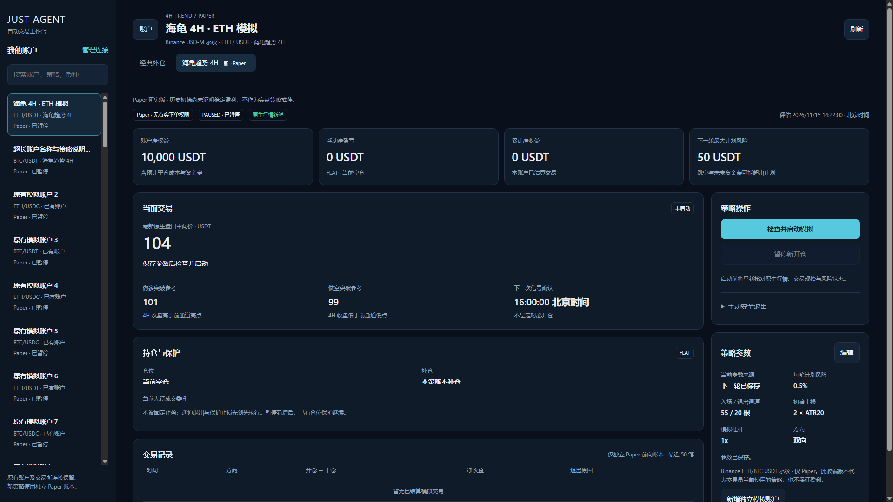
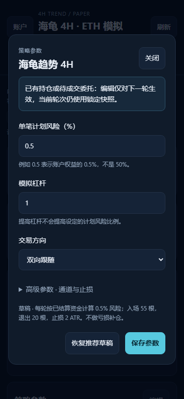

# JUST AGENT：海龟趋势 4H 与启动操作优化

用户选择：4 小时趋势跟随，交易较少、持仓较久。保留经典补仓、账户新增/切换及交易所连接；新增独立研究策略，不复原或迁移旧账户、不重置账本、不自动启动账户。

策略来源、改编边界和冻结参数见 [PROTOCOL.md](PROTOCOL.md)。它借鉴公开海龟规则，不能声称复制某位交易员当前的私有策略或保证盈利。

## 入口和操作

- 首页新增“海龟趋势 4H”入口：`/turtle.html`。保留经典工作台的右侧操作区与就近参数抽屉。
- 左侧是同一账户体系，支持搜索。选原账户回经典/只读工作台，选新策略账户进入对应 Paper 驾驶舱。
- 新策略只创建无密钥、停止状态的独立 Binance ETH/BTC USDT Paper 账户，不将已绑定账户直接切换策略。
- 参数编辑：常用项为风险百分比、杠杆、方向。通道/ATR 在高级折叠区。百分比在界面按 0.5 表示 0.5%，提交时换算为 0.005。
- 保存与启动分开。未保存草稿禁止启动；保存失败保留草稿。启动先重新读取原生报价、合约规格、已收盘 K 线、资金费，再列出核对项，明确确认后才启动。
- 确认窗口绑定已检查的 configHash；其他页面保存参数后，旧窗口不能用新参数偷偷启动。
- 已有仓位/待成交委托使用锁定参数。保存新值只用于下一轮，界面同时展示当前快照与差异提示。
- 暂停只禁止新增，保留止损与通道退出。手动退出须明确确认，且使用独立模拟订单生命周期。
- 经典账户启动也增加后端预检查，风险锁、旧残单、未保存参数、无有效报价均有具体错误。

## 执行与持久化

独立文件 `turtle_4h_paper.json`，写入采用临时文件、fsync、原子重命名。坏账本/未知委托不能静默复原为初始余额。委托先落盘，下一条新鲜原生盘口才允许模拟成交。盘口可见数量按 10% 参与限制，部分成交后取消剩余，不依靠轮询次数补足。

只访问 Binance **公共行情** K 线、BookTicker、ExchangeInfo、FundingRate。保留原生时间，网络返回之后评估新鲜度；不以接收时间冒充交易所时间、不回退到其他平台。参考 [Binance 原生行情文档](https://developers.binance.com/docs/derivatives/usds-margined-futures/market-data/rest-api/Symbol-Order-Book-Ticker)。

模拟止损使用触发后的不利真实盘口再叠加滑点，不编造触价即成交。历史研究缺少原生盘口，采用单独声明的保守情景，不计入前向账本。

新引擎没有真实下单、撤单、杠杆变更或转账方法，拒绝 Live、未知模式、错报价币种或携带密钥的账户。旧兼容接口不能改写它的账本、资金或状态。原有连接入口禁止向这一研究账户添加交易凭据。

## 历史初筛结论

固定默认，无参数搜索。数据为已用于其他研究的 Binance 2024 / 2025 历史，**不是新的独立样本外，也不是 Paper 实盘收益**。每组独立 10,000 USDT，包含手续费、声明的滑点与历史资金费标记价代理。

| 市场 / 年份 | 交易数 | 净盈亏 USDT | Profit Factor | 单笔净期望 USDT | 最大权益回撤 |
|---|---:|---:|---:|---:|---:|
| ETH 2024 | 36 | +271.02 | 1.22 | +7.53 | 9.21% |
| ETH 2025 | 37 | -161.78 | 0.88 | -4.37 | 7.30% |
| BTC 2024 | 36 | -215.45 | 0.85 | -5.98 | 9.19% |
| BTC 2025 | 38 | -782.74 | 0.42 | -20.60 | 10.02% |

四组中三组亏损，不能证明当前改编规则具备稳定优势。保留 Paper 研究标识，不以名气推荐实盘、不因已见结果随意放宽过滤或扩大杠杆。研究数据与哈希见 [research-results.json](research-results.json)。

## 验证与生产边界

自动化与浏览器验证见 [validation.json](validation.json)。六视口：1920×1080、1600×900、1440×900、1366×768、390×844、375×812。账户规模 64 / 100 / 150；包含参数保存、启动确认、暂停、活跃快照、待成交、失败草稿、断流和新建停止账户。

开发基线为生产兼容经典分支 `eb840d7`；GitHub main 查询为 `0681f2b`。与 H06 草稿 PR 独立，不合并 H06，也不直接合并 main。

线上后端实际是较早的 `9b327da` 加既有经典适配，server.js / terminal/api.js 与开发基线存在额外差异。**不能把本分支整个目录覆盖生产**。需另做逐项兼容发布审核，保持生产旧账户、认证、历史和风险保护。此次只进行隔离服务器 stage 和公共原生行情核验，不自动启动生产账户，不以研发完成冒充已上线。

截图仅为合成数据视觉验收：

