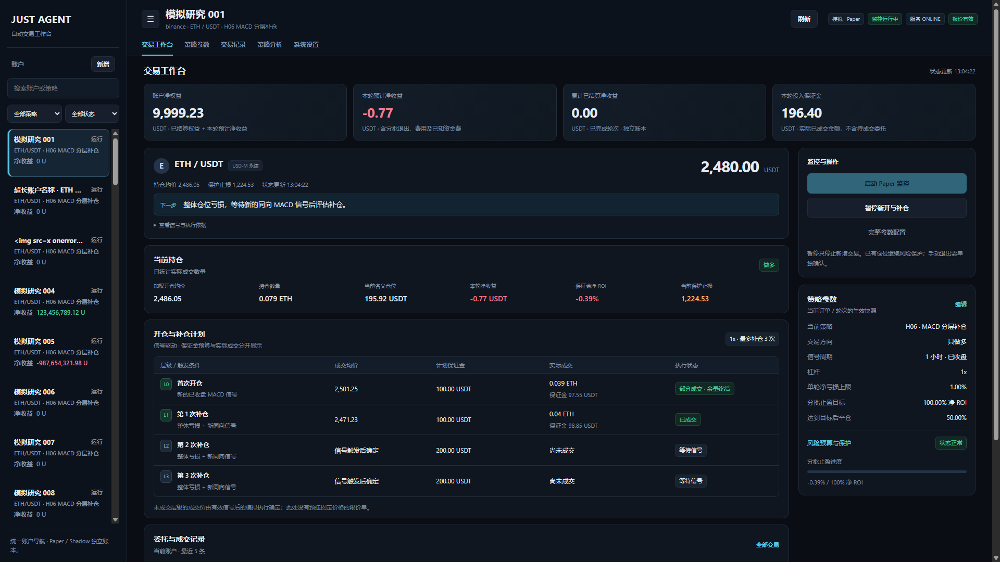

# JUST AGENT 单账户交易驾驶舱

前端基线：`4bb0c1e025f706043b63b5670b1c347b571e3b71`，H06草稿PR #1。按用户选择优先做好“一页看持仓、补仓、盈亏和参数”。本轮仅改前端展示、账户选择行为和相应测试，不修改策略、订单、风险、账户或历史数据；不合并main、不部署。

## 公开平台调研与选择

按实际操作方式匹配公开资料，主参考选Altrady的简洁终端，并结合3Commas的分层交易信息组织和Bitsgap的盈亏拆分。以下是功能与交互结构参考；JUST AGENT使用自行实现的组件、配色及品牌，没有引入第三方脚本、图片或交易策略。

| 参考 | 公开资料支持的做法 | 本项目实现 |
|---|---|---|
| [Altrady 简洁/高级终端布局](https://help.altrady.com/en/layouts-widgets/save-switch-layouts)；[终端入门](https://help.altrady.com/en/start-here/learn-the-trading-terminal) | 交易面板、持仓及订单集中于同一终端，可按任务安排组件 | 统一账户导航 + 中央持仓/执行表 + 右侧操作和参数 |
| [3Commas Trading Terminal](https://help.3commas.io/en/articles/16281054-trading-terminal-overview)；[DCA 配置](https://help.3commas.io/en/articles/16281102-how-the-dca-bot-works-strategy-setup-guide) | 交易方向、账户、分层金额与参数明确组织 | 当前账户、层级预算、实际成交与当前/下一轮配置分别显示 |
| [Bitsgap 机器人详情](https://bitsgap.com/helpdesk/article/10025414349212-Monitor-bot-s-performance-in-the-detailed-view-window) | 将已实现收益、持仓盈亏、均价与资金分配区分 | 账户净权益、本轮预计净收益、已结算净收益、实际保证金四项摘要 |

选择依据是单账户日常操作匹配度。资料调研不构成盈利、交易安全或全球排名结论。

## 新工作台

- 左侧统一账户栏：搜索、筛选、固定高度卡片、当前选中状态；63/100/150账户独立滚动。手机沿用同一账户控制器的下拉/抽屉。
- 顶部明确区分模式、监控运行、服务响应和报价有效性。Paper、Shadow有中文说明；报价失效时，当前价格和浮动估值不冒充实时数字。
- 四项资金摘要：净权益、本轮预计净收益、累计已结算净收益、实际投入保证金。金额与保证金ROI分别标单位。
- 当前价格、仓位均价、实际数量、名义仓位、止损和净盈亏集中显示。小价格保持足够精度，不把极小止损显示成0。
- 四层执行表：首仓/补仓触发条件、已成交均价、计划保证金、实际成交数量/保证金和订单状态。H06未成交价明确“信号触发后确定”，不伪装成固定价格限价单。
- 右侧启动/暂停操作保持可见；参数编辑打开侧边抽屉，使用原有表单、校验和保存接口。完整参数页继续可用。
- 当前配置与下一轮配置分开。当前订单和轮次不因修改新参数而变化；取消前确认草稿、失败保留输入并在抽屉内提示、成功提示下一轮生效。
- 信号指标、风险明细和手动安全退出通过展开查看；退出与暂停继续使用原有确认流程。
- 最近委托来自原账户真实返回，不构造历史K线或演示成交。界面截图由独立合成fixture生成，不能当作Paper业绩。

## 配置与移动端

[桌面参数抽屉](parameters-desktop.png) · [手机参数抽屉](parameters-mobile.png) · [手机主界面](mobile-390.png) · [150账户手机抽屉](mobile-accounts.png) · [报价不可用](mobile-noquote.png)。

本轮顺便修复一个账户导航问题：搜索只筛选账户卡片，手机选择器仍保留全部账户及当前选中身份，避免搜索后下拉显示另一个账户。

## 验收

全量自动测试：**437通过、0失败、0跳过**，原交易核算、安全和品种脚本通过。新增搜索/账户选择身份回归。

浏览器：**58个视图场景 + 24组交互流程通过，0浏览器异常**。包括H06原30场景、新增18个大账户视口组合及10个空仓/失效报价/风险锁/待成交/暂停场景。交互检查账户搜索切换、侧栏、手机抽屉、参数保存失败/成功、草稿确认、锁定快照及暂停/启动确认，仅访问本机合成测试服务。

| 视口 | 账户规模 | 卡片最小高度 | 账户列表 | 横向溢出 | 首屏说明 |
|---|---|---|---|---|---|
| 1920×1080 | 63 / 100 / 150 | 92px | 独立滚动 | 无 | 持仓底部602px；执行表底部996px |
| 1600×900 | 63 / 100 / 150 | 92px | 独立滚动 | 无 | 持仓底部602px；执行表底部996px |
| 1440×900 | 63 / 100 / 150 | 92px | 独立滚动 | 无 | 持仓底部660px；执行表底部1054px |
| 1366×768 | 63 / 100 / 150 | 92px | 独立滚动 | 无 | 持仓底部656px；执行表底部1051px |
| 390×844 | 63 / 100 / 150 | 92px | 下拉 / 独立抽屉 | 无 | 纵向卡片；账户抽屉展开后也核验高度与宽度 |
| 375×812 | 63 / 100 / 150 | 92px | 下拉 / 独立抽屉 | 无 | 纵向卡片；账户抽屉展开后也核验高度与宽度 |

1920×1080下完整执行表位于首屏；较低屏幕需要正常纵向滚动，未宣称所有内容都能塞入所有视口。页面和main均无横向溢出。手机将执行行改为卡片排列，不缩放宽表。

详情：[大账户与状态视口结果](visual-results.json)、[H06既有30场景结果](h06-regression-results.json)。开发时更新了旧版“当前决策”文案断言，之后全部检查通过。

## 改动范围

- `public/index.html`：统一驾驶舱结构、参数抽屉、导航文案。
- `public/terminal/workbench.js`：只读数据展示与原表单/原控制器的交互入口。
- `public/terminal/workbench.css`：深色/青色体系、信息层级、响应式布局。
- `public/terminal/layout.js`：修复搜索时手机账户选择器身份显示。
- `tests/workbench_ui_fixture.js`、`tests/workbench_visual_check.js`：独立合成账户与交互验收。
- `tests/h06_visual_check.js`、`tests/trend_frontend.test.js`：对应新界面与账户身份断言。

核心交易参数：**没有变化**。server、API、policy、迁移、所有runtime和策略代码均未改；H06的原生前向阻断与草稿合并限制继续有效。没有创建或启动生产账户，没有真实交易调用，没有部署服务器。

本轮成果是可运行的前端实现与截图；GitHub PR head标识最终代码版本，线上界面不会自动变化。
